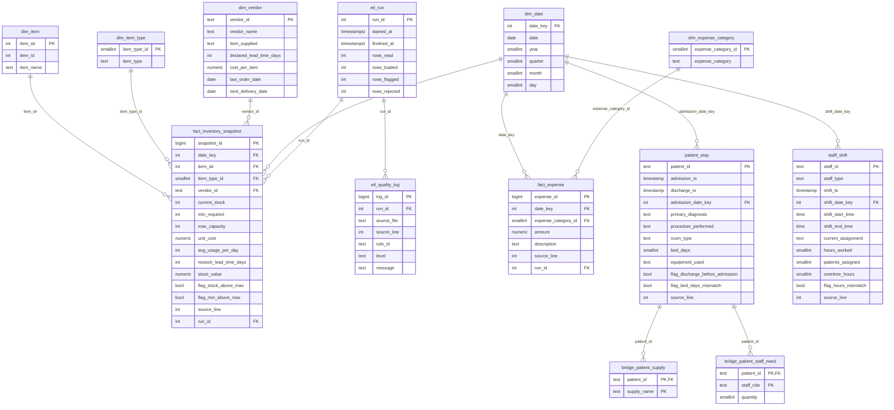

# Especificação: dashboard de gestão de stock hospitalar

Versão 1.0, 2026-11-17. Vocabulário em `GLOSSARY.md`. Decisões difíceis de reverter em `docs/adr/`. Perfil e regras dos dados em `docs/data-quality.md`.

Fontes, por ordem de prioridade: `Enunciado_02_Aprovisionamento_Hospitalar.pdf` (prevalece), `7. Gestão de stocks e Indicadores.pdf` (referido como "slide N"), `practice_class.html` (Parte 4), CSV de `2-Hospital_Dataset`. Não foram encontradas contradições entre o enunciado e o prompt inicial.

## 1. Contexto e objetivo

O serviço de aprovisionamento tem ruturas pontuais em alguns materiais e excesso de stock noutros. A administração quer reduzir o valor imobilizado sem comprometer a disponibilidade. Não há licenças de Power BI: construímos uma aplicação web com a experiência de um relatório (filtros, interação entre visuais, drill-down, drill-through, cartões KPI). O dashboard serve a gestão logística, não decisões clínicas.

Pergunta de partida: *que conhecimento queremos gerar com estes dados para o gestor tomar melhores decisões de compra?*

Arquitetura (do enunciado): browser → Next.js → NestJS → PostgreSQL. O browser nunca lê os CSV nem acede à base de dados. Todos os cálculos, filtros, frases-insight e simulações são feitos no servidor.

## 2. Utilizador, perfis e perguntas

**Utilizador principal:** responsável do Serviço de Aprovisionamento e Logística. Revê o stock diária e semanalmente, decide o que encomendar e quando, negoceia com fornecedores e reporta o valor imobilizado.

**Perfis secundários** (usados nos layouts guardados, onda 4): Diretor/administração (capital e risco num relance) e Comprador (lista de compras e fornecedores).

Cadeia **Pergunta → Decisão → KPI → Visual → Página**:

| # | Pergunta | Decisão | KPI | Visual | Página |
|---|---|---|---|---|---|
| P1 | Que artigos vão entrar em rutura antes de chegar a próxima entrega? | O que encomendar já e por que ordem | Autonomia, dias de folga, abaixo do mínimo, nível de triagem, PE | Cartões KPI, distribuição de triagem, dispersão autonomia × LT, calendário de rutura (onda 2), tabela de triagem | 1, 2, 4 |
| P2 | Onde está o capital imobilizado em excesso? | Que encomendas suspender ou reduzir e que máximos rever | Valor de stock, capital em excesso, stock parado, ABC, rotação | Cartão de capital em excesso, Pareto ABC, barras de excesso por artigo, tendência da rotação | 1, 2, 4 |
| P5 | Que fornecedores comprometem a disponibilidade? | Com quem renegociar prazos ou procurar alternativa | LT médio e variabilidade, prometido vs. real, índice de risco, ruturas previstas por fornecedor | Barras com intervalo (LT por fornecedor), tabela prometido vs. real, matriz de risco | 3 |

Cada pergunta tem de permitir chegar a pelo menos uma conclusão suportada por valores (critério de aceitação AC-30, secção 12).

Contexto/backlog (não são compromissos): P3, P4, P6, P7 (a comparação temporal é obrigatória e cobre-a em parte), P8, P9, P10.

## 3. Dicionário de dados

### 3.1 `inventory_data.csv` → `fact_inventory_snapshot`

| Coluna CSV | Coluna alvo | Tipo | Significado | Problemas |
|---|---|---|---|---|
| `Date` | `date_key` / `snapshot_date` | date | Dia do snapshot | Um snapshot por dia, de um só artigo |
| `Item_ID` | `dim_item.item_id` | int | Código do artigo | Não determina o nome |
| `Item_Name` | `dim_item.item_name` | text | Nome do artigo | 5 valores |
| `Item_Type` | `item_type_id` → `dim_item_type` | text | Consumível ou equipamento | Varia no mesmo artigo (49 de 50) |
| `Current_Stock` | `current_stock` | int | Unidades em stock no dia | — |
| `Min_Required` | `min_required` | int | Stock mínimo | Excede o máximo em 13 registos |
| `Max_Capacity` | `max_capacity` | int | Stock máximo | Excedido em 186 registos |
| `Unit_Cost` | `unit_cost` | numeric(12,2) | Custo unitário no snapshot | Aleatório e irrealista |
| `Avg_Usage_Per_Day` | `avg_usage_per_day` | int | Consumo médio diário (unidades) | Não há movimentos de saída |
| `Restock_Lead_Time` | `restock_lead_time_days` | int | Tempo de reposição em dias | Fonte principal do LT |
| `Vendor_ID` | `vendor_id` | text | Fornecedor no snapshot | Varia no mesmo artigo |
| (derivada) | `stock_value` | numeric | `current_stock × unit_cost` | — |
| (derivadas) | `flag_stock_above_max`, `flag_min_above_max` | bool | Flags do ETL (R10, R11) | — |

### 3.2 `vendor_data.csv` → `dim_vendor`

`Vendor_ID`→`vendor_id`, `Vendor_Name`→`vendor_name`, `Item_Supplied`→`item_supplied`, `Avg_Lead_Time (days)`→`declared_lead_time_days`, `Cost_Per_Item`→`cost_per_item`, `Last_Order_Date`→`last_order_date`, `Next_Delivery_Date`→`next_delivery_date`. Derivada: `dates_lead_time_days = next_delivery_date − last_order_date` (V001 5, V002 44, V003 20 dias).

### 3.3 Os outros três CSV (carregados, sem KPI)

O enunciado exige carregar os CSV para PostgreSQL, por isso o ETL carrega **os 5 ficheiros**. Estes três ficam disponíveis no modelo, normalizados e com qualidade assinalada, mas **nenhum KPI ou visual escolhido depende deles** (ver secção 14).

| CSV | Tabela | Transformações |
|---|---|---|
| `financial_data.csv` | `fact_expense` | `Date`→`date_key`; `Expense_Category`→`expense_category_id` (lookup); `Amount`→`amount`; `Description`→`description` |
| `patient_data.csv` | `patient_stay` | Datas-hora, snake_case; `Supplies_Used` e `Staff_Needed` **decompostos** (1NF) em `bridge_patient_supply` e `bridge_patient_staff_need` |
| `staff_data.csv` | `staff_shift` | `Shift_Date`→timestamp; `Shift_Start_Time` e `Shift_End_Time` ("08:00 AM") → `time`; snake_case |

Decomposição das listas: `"Gloves, IV"` → (`Gloves`), (`IV`); `"1 Nurse, 1 Doctor"` → (`Nurse`, 1), (`Doctor`, 1); `"2 Surgeons"` → (`Surgeon`, 2) (papel no singular).

## 4. ETL, limpeza e conformidade

O ETL é reprodutível e equivale aos "passos aplicados" do Power Query: passos ordenados, versionados, re-executáveis. O comando de refresh volta a carregar tudo a partir dos CSV, numa só transação, de forma idempotente. Os CSV nunca são alterados. Caminhos e credenciais vêm de variáveis de ambiente.

### 4.1 Passos (por esta ordem)

| # | Passo | Detalhe |
|---|---|---|
| 1 | Ler | CSV em UTF-8 como texto para `staging`, com o nº da linha de origem |
| 2 | Perfilar | Tipo, % nulos, distintos, mín/máx e valores fora do domínio por coluna; escreve `docs/data-quality.md` |
| 3 | Normalizar texto | Aparar espaços; `Item_Type` e nomes com capitalização canónica |
| 4 | Renomear | snake_case sem espaços nem parênteses (`Avg_Lead_Time (days)` → `declared_lead_time_days`) |
| 5 | Converter tipos | Datas ISO, inteiros, decimais. Falha → R02/R03 |
| 6 | Validar chaves | Duplicados (R04) e referencial `vendor_id` (R05) |
| 7 | Assinalar domínio | R10–R13 |
| 8 | Derivar | `stock_value`, mês, ano, trimestre, flags |
| 9 | Carregar | Dimensões, depois facto. Os rejeitados não entram no facto |
| 10 | Registar | `etl_run` e `etl_quality_log` (motivo por registo) |

### 4.2 Regras

Regra geral: **nunca apagar em silêncio**. Cada registo problemático é rejeitado ou assinalado com motivo. Só se rejeita o que é ilegível (decisão da equipa).

| Regra | Nível | Condição | Efeito nos KPI |
|---|---|---|---|
| R01 | Rejeitar | Linha com nº de colunas errado | Não carregada |
| R02 | Rejeitar | Data inválida | Não carregada |
| R03 | Rejeitar | Número não interpretável | Não carregada |
| R04 | Rejeitar | Chave duplicada (data + artigo) | Não carregada |
| R05 | Rejeitar | `vendor_id` inexistente em `dim_vendor` | Não carregada (não cabe na chave estrangeira) |
| R10 | Assinalar | `current_stock > max_capacity` | Nenhuma exclusão. Alimenta o capital em excesso |
| R11 | Assinalar | `min_required > max_capacity` | **Excluído dos KPI que usam `min_required`**: abaixo do mínimo (K5) e a regra "abaixo do mínimo sobe para nível ≥ 4" da triagem (K10). Conta nos restantes, incluindo SS e PE, que não usam o mínimo |
| R12 | Assinalar | Stock < 0, custo ≤ 0, consumo < 0 ou LT ≤ 0 | Excluído dos KPI que usam a coluna inválida |
| R13 | Assinalar | `item_type` fora da lista (Consumable, Equipment) | Aparece como "Desconhecido" no filtro de tipo |
| R20 | Assinalar | `patient_stay`: alta anterior à admissão | Sem KPI afetado (ficheiro fora dos KPI) |
| R21 | Assinalar | `patient_stay`: `bed_days` difere mais de 1 dia de (alta − admissão), em dias completos decorridos (truncados) | Idem |
| R22 | Assinalar | Célula de lista não decomponível (`Supplies_Used`, `Staff_Needed`) | Não gera linhas na tabela ponte; registo mantido |
| R30 | Assinalar | `staff_shift`: duração (fim − início, com viragem de dia) difere mais de 0,01 h de `hours_worked` | Sem KPI afetado |

R01–R05 aplicam-se aos 5 ficheiros (R04: chave primária própria de cada um; R05: referencial do inventário contra `dim_vendor`). R12 aplica a R11 o mesmo princípio e não ocorre nos dados atuais.

Estado esperado após o primeiro carregamento (AC-03):

| Ficheiro | Lidos | Assinalados | Rejeitados |
|---|---|---|---|
| `inventory_data` | 500 | 187 (R10 ou R11) | 0 |
| `vendor_data` | 3 | 0 | 0 |
| `financial_data` | 500 | 0 | 0 |
| `patient_data` | 500 | 451 (R21; os 195 de R20 estão incluídos) | 0 |
| `staff_data` | 500 | 459 (R30) | 0 |
| **Total** | **2003** | **1097** | **0** |

Total: 906 tratados (45,2 %), 1097 assinalados (54,8 %), 0 rejeitados. O rodapé da aplicação mostra o total e, ao expandir, o detalhe por ficheiro, mais a data da última atualização (`etl_run`). O inventário, que alimenta os KPI, tem 313 tratados (62,6 %) e 187 assinalados (37,4 %).

### 4.3 Limitações do dataset (declaradas, não corrigidas)

`Unit_Cost` aleatório e irrealista; tipo e fornecedor instáveis por artigo; um snapshot por dia de um só artigo; cerca de 10 observações por artigo; sem movimentos de saída; `vendor_data` com 3 linhas.

## 5. Modelo de dados (estrela, 3NF, PostgreSQL)



- `dim_item`: PK `item_sk`; **UNIQUE (`item_id`, `item_name`)** (ADR 0001). Só estas duas colunas descrevem o artigo.
- `fact_inventory_snapshot`: PK `snapshot_id`; **UNIQUE (`date_key`, `item_sk`)**; `restock_lead_time_days > 0` e `unit_cost > 0` não são `CHECK` na base: violações são assinaladas (R12), não impedidas.
- `dim_date`: gerada pelo ETL para todo o intervalo de datas dos 5 ficheiros.
- `fact_expense`, `patient_stay`, `bridge_patient_supply`, `bridge_patient_staff_need` e `staff_shift` existem para cumprir o carregamento dos 5 CSV (1NF/3NF) e ficam fora dos KPI. As colunas de baixa cardinalidade (diagnóstico, procedimento, tipo de quarto, equipamento, tipo de staff, serviço) ficam como texto: não dependem de outro atributo não chave, por isso a 3NF mantém-se.
- `dashboard_layout` (onda 4): PK `profile`; colunas `layout_json`, `updated_at`. Fora do esquema em estrela.
- Atributos que variam (tipo, fornecedor, custo, mínimo, máximo, consumo, LT) vivem no facto, não em `dim_item`.

## 6. Catálogo de KPI

**Dimensões:** artigo, tipo (do snapshot), fornecedor (do snapshot), classe ABC, nível de triagem, data (ano → mês → dia). **Métricas** (sem juízo): stock, consumo, valor, LT. **KPI:** métricas com alvo e estado.

Convenções comuns:
- **Snapshot de referência**: último snapshot de cada artigo até à data de corte (fim do período filtrado). Se tiver mais de 90 dias (parâmetro), o artigo fica marcado "desatualizado".
- Agregar sobre artigos usa a **mediana** quando a distribuição tem caudas longas (a autonomia tem percentil 10 de 2,2 dias e máximo de 382) e a soma para valores em €.
- Estados: OK / atenção / crítico, codificados por intensidade + ícone + forma (secção 9). Todos os limiares são parametrizáveis.
- Cada KPI tem um painel "Como é calculado" (ícone i) com fórmula, fonte, aproximação e limitações. O conteúdo vem de `GET /api/kpis/:id/explain`.

### 6.1 KPI mínimos do enunciado

| ID | KPI | Fórmula | Fonte | Colunas | Unidade e granularidade | Alvo / limiar | Nulos e zeros | Aproximação e limitações |
|---|---|---|---|---|---|---|---|---|
| K1 | **Autonomia** | `current_stock / avg_usage_per_day` | slide 111 (taxa de cobertura), enunciado | `current_stock`, `avg_usage_per_day` | dias; por artigo (snapshot de referência) e agregada (mediana) | Via dias de folga (K6) | Consumo 0 → autonomia **indefinida** (nula), artigo marcado "sem consumo", fora da mediana e contado no stock parado. Não ocorre hoje | Assume consumo constante igual ao `avg_usage_per_day` do dia |
| K2 | **Rotação** | `RS = consumo estimado / stock médio`, com consumo estimado = média de `avg_usage_per_day` dos snapshots do período × dias do período (inclusivos) e stock médio = média de `current_stock` dos snapshots do período. Versão em valor: consumo × custo unitário médio do período / média de `stock_value` | slide 110 | `avg_usage_per_day`, `current_stock`, `unit_cost` | vezes por período (expõe também a versão anualizada `× 365 / dias`); por artigo e agregada | Sem alvo (decisão: não inventar um). Mostra tendência e comparação | Período sem snapshots do artigo → nulo, contado em "sem dados" | **Aproximação:** não há movimentos de saída. Cerca de 10 snapshots por artigo: stock médio frágil |
| K3 | **Tempo médio de reposição** | Média de `restock_lead_time_days` dos snapshots do período; mostra também desvio-padrão e coeficiente de variação | slide 5 (LT), enunciado | `restock_lead_time_days`, `vendor_id` | dias; por artigo, fornecedor e global | Sem alvo; compara fornecedores | LT ≤ 0 → R12 | Fonte principal: inventário. O `vendor_data` (declarado e datas) só mostra a divergência "prometido vs. real" e cobre 3 fornecedores |
| K4 | **Classe ABC** | Secção 7 | slides 14–24 | `current_stock`, `unit_cost` | A / B / C; por artigo | A ≤ 80 %, B ≤ 95 % do valor acumulado (parametrizável) | Valor 0 → classe C | **Valor de stock** (como o enunciado), não consumo anual (como a aula). `unit_cost` é aleatório por snapshot: a classe reflete o snapshot, não o valor estrutural |
| K5 | **Artigos abaixo do mínimo** | `current_stock < min_required` | enunciado | `current_stock`, `min_required` | contagem, % e lista; por artigo no snapshot de referência e por mês (% de snapshots) | % ≤ 5 % OK, ≤ 10 % atenção, > 10 % crítico | **Universo elegível**: exclui snapshots R11 (`min > max`). O número excluído aparece ao lado | A série mensal usa snapshots do mês, não o estado de todos os artigos |

### 6.2 KPI adicionais (escolhidos e justificados)

| ID | KPI | Fórmula | Fonte | Alvo / limiar | Justificação e limitações |
|---|---|---|---|---|---|
| K6 | **Dias de folga** | `autonomia − restock_lead_time_days` | prompt, slide 62 (PE) | ≥ 7 OK; 0 a 7 atenção; < 0 crítico | Responde diretamente à P1: negativo = rutura prevista antes da entrega. Reutiliza K1 e K3 |
| K7 | **Capital em excesso (€)** | `Σ max(0, current_stock − max_capacity) × unit_cost` no snapshot de referência; também em % do valor total | prompt, slide 14 | ≤ 5 % OK; ≤ 10 % atenção; > 10 % crítico (do valor total) | KPI que a administração mais quer. O máximo é a política do hospital. Valores em € irrealistas (custo aleatório). Conta artigos R11 (usa só o máximo) |
| K7b | **Stock parado** (segunda vista do capital em excesso) | `Σ max(0, current_stock − X × avg_usage_per_day) × unit_cost`, X = 60 dias por defeito | prompt | Informativo, sem estado | Substitui "sem movimento há N dias", **inviável** porque não há movimentos. Nunca se soma a K7 |
| K8 | **Stock de segurança** | `SS = ⌈σ × Z × √LT⌉`, σ = desvio-padrão **populacional** (÷ n) de `avg_usage_per_day` do artigo em todos os snapshots até à data de corte; LT em dias; `Z` por classe: A 99 % (2,33), B 97,5 % (1,96), C 95 % (1,645) | slides 58–61, 70 | — | `σ` e LT na mesma unidade (por dia). Cerca de 10 observações: aviso de **confiança baixa** abaixo de 8. Parâmetros editáveis (95 % a 99 %) |
| K9 | **Ponto de encomenda** | `PE = avg_usage_per_day × LT + SS` (consumo e LT do snapshot de referência) | slides 62, 71 | `stock < PE` → encomendar | Base da sugestão de encomenda (onda 3) e da triagem. Não usa `min_required`, por isso R11 não o exclui |
| K10 | **Nível de triagem (1–5)** | `nível = 1 + P_posição + P_ABC`. `P_posição`: `stock ≥ PE` → 0; `avg_usage × LT ≤ stock < PE` → 2; `stock < avg_usage × LT` → 3. `P_ABC`: classe A → 1, senão 0. Se `stock < min_required` e o snapshot não é R11, `nível = max(nível, 4)` | slides 19, 62, 71 (combinação nossa) | — | Heurística do projeto: não existe padrão da indústria. Sem limiares inventados: todos os cortes vêm de fórmulas da aula. Distribuição no snapshot de referência é pesada nos níveis 4–5 (secção 12) |
| K11 | **Índice de risco do fornecedor** | Média dos **ranks** (1 a 3, 1 = melhor) de: LT médio, coeficiente de variação do LT, e % de artigos em risco (folga < 0) do fornecedor | prompt | Informativo (ordenação) | Combina média e variabilidade. **Peso igual, sem inventar pesos.** Com 3 fornecedores quase iguais em LT, a conclusão esperada é "nenhum se distingue" |
| K12 | **Prometido vs. real** | `declared_lead_time_days` e `dates_lead_time_days` (do `vendor_data`) comparados com o LT médio do inventário do mesmo fornecedor | enunciado | Divergência em dias | Só 3 linhas. V002 declara 30 e as datas dão 44 |
| K13 | **Rutura prevista** | % de artigos com dias de folga < 0 no snapshot de referência | slide 112 (taxa de rutura, aproximada) | = K6 crítico | Aproxima a taxa de rutura (sem requisições) |
| K14 | **Qualidade dos dados** | % tratados, assinalados e rejeitados no ETL | secção 4 | — | Rodapé |

Valores calculados no snapshot de referência (dados completos, 2026-02-12) para validar a implementação, não como substituto do cálculo manual: 50 artigos; 29 com dias de folga negativos; 19 acima do máximo; valor de stock de 1 187 053 873 €; capital em excesso de 236 614 283 € (19,9 %); 6 artigos com autonomia > 60 dias e stock parado de 112 653 424 €; abaixo do mínimo: 2 (de 47 elegíveis; 3 artigos excluídos por R11).

### 6.3 Frases-insight

Geradas no servidor por **templates determinísticos** (`GET /api/insights`), recalculadas com os filtros ativos. Cada número vem de uma query; se faltarem dados, a frase omite a cláusula em vez de inventar. Exemplos com os valores atuais:

| Página | Template | Exemplo (valores reais) |
|---|---|---|
| 1 Pulso | `{n_folga_neg} de {n_artigos} artigos têm dias de folga negativos; o capital em excesso é {excesso_eur} ({excesso_pct} % do valor de stock).` | "29 de 50 artigos têm dias de folga negativos; o capital em excesso é 236,6 M€ (19,9 % do valor de stock)." |
| 2 Onde dói | `{n_A_risco} artigos de classe A estão em nível de triagem 4 ou 5.` | (calculado em runtime) |
| 3 Porquê | `O LT médio varia entre {min_lt} e {max_lt} dias entre fornecedores; {fornecedor} tem o maior desvio ({cv}).` | Se a diferença for pequena, a frase diz que nenhum fornecedor se distingue |
| 4 Receita | `{n_encomendar} artigos estão abaixo do ponto de encomenda; encomendar já os de nível 5 liberta/evita {n5} ruturas previstas.` | (calculado em runtime) |

## 7. Método ABC passo a passo

1. Calcular o **valor de stock** de cada artigo no snapshot de referência: `current_stock × unit_cost`.
2. Ordenar os artigos por valor, de forma decrescente.
3. `% valor = valor / total × 100`.
4. `% valor acumulada` = soma da linha anterior com a atual.
5. `% referências acumulada` = posição / n (cada artigo vale 1/n).
6. Classificar: **A** se `% acumulada ≤ corte_A`; **B** se `≤ corte_B`; **C** caso contrário. O primeiro artigo é sempre A. Cortes por defeito: 80 % e 95 % (parametrizáveis).
7. A classe calcula-se sobre **todos os artigos do período, antes** dos filtros de tipo, fornecedor, artigo e triagem. Só o filtro "classe" a usa depois.

Resultado no snapshot de referência completo: A = 24, B = 13, C = 13 artigos (A é 48 % dos artigos para 80 % do valor: concentração baixa).

**Exemplo da aula (teste obrigatório, slides 22–24):** 8 artigos, 120 €, valores 001=5, 002=40, 003=15, 004=3, 005=38, 006=1, 007=2, 008=16. Acumulados: 002 33,3 %; 005 65,0 %; 008 78,3 %; 003 90,8 %; 001 95,0 %; 004 97,5 %; 007 99,2 %; 006 100 %. Resultado da aula: A = {002, 005}, B = {008, 003}, C = {001, 004, 007, 006}.

> **Decisão (equipa, 2026-11-17):** o exemplo da aula **não tem de coincidir com os cortes 80/95**. A docente indicou que os cortes se podem adaptar, e a própria aula (slide 23) usa o método das "quebras" (a queda de 31,7 % para 13,3 % fecha a classe A) e diz que 70–80 % são orientações, não regras rígidas. Com 80/95 o mesmo exemplo daria A = {002, 005, 008}, B = {003, 001}, C = {004, 007, 006}, o que é aceitável. A função de ABC recebe os cortes como parâmetros; **o teste da aula usa os cortes 66 % e 91 %** (as quebras da aula, com margem para não comparar igualdade de decimais). Os cortes por defeito do dashboard continuam 80/95.

## 8. Storyboard das 4 páginas

Leitura de cima para baixo em todas: **topo** frase-insight + cartões KPI; **meio** gráficos que explicam o porquê; **fim** tabela acionável e exportável. Todas partilham: barra de filtros (secção 8.5), navegação, rodapé de qualidade dos dados, tooltips, painel de detalhe (drill-through).

### 8.1 Página 1: "Pulso do hospital" (principal) — P1 + P2 + P5

| Zona | Conteúdo |
|---|---|
| Topo | Frase-insight (secção 6.3). Cartões: K1 autonomia (mediana), K2 rotação, K3 LT médio, K4 distribuição ABC, K5 abaixo do mínimo, capital em excesso (K7) |
| Meio | Distribuição de níveis de triagem (barras, 1–5); **tendência mensal** de "% de registos abaixo do mínimo" e do LT médio, com mês vs. mês anterior (comparação temporal) |
| Fim | Tabela dos artigos nível 4–5 (artigo, classe, autonomia, folga, nível), ordenável; clicar abre o painel de detalhe |

### 8.2 Página 2: "Onde dói" — P1 + P2

| Zona | Conteúdo |
|---|---|
| Topo | Frase-insight; cartões: abaixo do mínimo, rutura prevista (K13), capital em excesso, stock parado |
| Meio | Dispersão **autonomia × LT** (a diagonal é a folga zero); **Pareto ABC** (barras de valor + linha acumulada); barras de excesso por artigo; calendário de rutura iminente (onda 2: data = data do snapshot + autonomia, consumo constante) |
| Fim | Tabela com artigos acima do máximo e abaixo do mínimo, com marca de "desatualizado" |

**Drill-down:** hierarquia **Tipo → Artigo** nas barras de excesso (clicar na barra do tipo expande para artigos).

### 8.3 Página 3: "Porquê" — P5

| Zona | Conteúdo |
|---|---|
| Topo | Frase-insight (que diz se nenhum fornecedor se distingue); cartões por fornecedor: LT médio, desvio, índice de risco |
| Meio | Barras com intervalo de LT por fornecedor; tabela **prometido vs. real** (K12); sazonalidade mensal do LT com a ressalva de base fraca (cerca de 10 observações por artigo) |
| Fim | Artigos em risco por fornecedor (folga < 0), exportável |

### 8.4 Página 4: "Receita" — P1 + P2 + P5

| Zona | Conteúdo |
|---|---|
| Topo | Frase-insight; cartões: nº de artigos abaixo do PE, nível 5, capital em excesso |
| Meio (onda 3) | Lista de triagem ordenada; **sugestão de encomenda**: PE, SS e o motivo (sem QEE); **antes vs. depois** do capital imobilizado |
| Meio (onda 4) | Simulador "E se…?" (secção 8.6) |
| Fim | Lista de compras com botão **Exportar CSV** |

**Antes vs. depois (regra explícita):** liberta-se o capital em excesso K7 dos artigos acima do máximo se as encomendas desses artigos forem suspensas até o stock voltar ao máximo; `antes = valor de stock total`, `depois = antes − K7`. Não prevê consumo nem preços.

### 8.5 Filtros globais, URL e interação

- Filtros (slicers): artigo, período, tipo, fornecedor, classe ABC, nível de triagem. Aplicados a **todos** os visuais da página e partilhados entre páginas.
- **Estado no URL**: `?periodo=2025-Q3&classe=A&tipo=Equipment&fornecedor=V002&triagem=4,5&artigo=108:xray-machine`. `periodo` aceita `2025`, `2025-Q3`, `2025-09` ou `2025-01-01..2025-03-31`; sem filtro = intervalo completo.
- **Cross-filter**: clicar numa barra, fatia ou célula acrescenta o filtro correspondente ao URL (e destaca os outros visuais). Clicar de novo remove-o.
- **Tooltip**: em todos os visuais. Exemplo obrigatório: no gráfico de tendência mostra o mês, o valor, o mês anterior, a variação e o **nº de snapshots**.
- **Drill-through (painel lateral, sem 5.ª página):** `?detalhe=artigo:108:xray-machine` ou `?detalhe=fornecedor:V002`. Abre um painel com o histórico do artigo (stock, mínimo, máximo, autonomia, PE), triagem, classe e snapshots, ou o perfil do fornecedor. Fecha sem perder os filtros.
- **Comparação temporal:** mês a mês, só do que foi registado no mês, **sem carregar valores para a frente**, com o nº de snapshots visível. Os cartões usam o snapshot de referência; a tendência chama-se "% de registos abaixo do mínimo no mês" para não parecer o mesmo número.
- **Regras quando o período corta dados:** (1) a classe ABC calcula-se sobre todos os artigos do período, antes dos outros filtros; (2) um artigo sem snapshots no período não entra nos KPI e conta-se em "N artigos sem dados no período", nunca como zero.

### 8.6 Simulador "E se…?" (onda 4)

Dois parâmetros: **LT +N dias** (global; por fornecedor opcional) e **consumo +Y %**. O backend recalcula folga, PE e triagem e devolve **só** o nº de artigos que passam a ter folga negativa e a variação da distribuição de triagem. Não prevê nada além disso.

### 8.7 Layouts por perfil (onda 4)

Mosaicos arrastáveis e redimensionáveis, com layout guardado no backend **por perfil** (Diretor, Gestor de armazém, Comprador), sem autenticação, e botão "repor por defeito" que apaga o layout do perfil. O layout por defeito segue topo/meio/fim.

## 9. Guia de tema visual

- **Cor única: azul-petróleo**, 5 tons de intensidade. Valores indicativos a validar com contraste WCAG AA em ambos os modos: tom 1 `#E3F1F3`, tom 2 `#9CCDD6`, tom 3 `#4A9AAA`, tom 4 `#1F6E7E`, tom 5 `#0B3F4A`. Sem semáforo vermelho/âmbar/verde.
- **Alerta sem depender da cor** (intensidade + ícone + forma):

| Estado | Codificação |
|---|---|
| OK | Barra cheia, sem ícone |
| Atenção | Barra cheia com borda **tracejada** e ícone de triângulo |
| Crítico | Ícone de **pulso** (animado, desligado com `prefers-reduced-motion`) e borda grossa |

- **Triagem 1–5:** emblema com o **número**, tom proporcional ao nível e, nos níveis 4 e 5, ícone de pulso. O número nunca depende da cor.
- **Cabeçalho "sinais vitais"** (onda 2): linha ECG subtil cujo ritmo aumenta com o nº de artigos em nível 5. Respeita `prefers-reduced-motion` e não compete com os dados.
- **Dois modos:** "Consulta" (claro, por defeito) e "Bloco operatório" (escuro).
- Espaço em branco generoso, tipografia legível, ícones simples, layout que funciona em ecrã de portátil.

## 10. Funcionalidades: obrigatório / valoriza / wow

| Funcionalidade | Nível | Onda |
|---|---|---|
| Página principal + 3 subpáginas e navegação | Obrigatório | 1 |
| 5 KPI mínimos | Obrigatório | 1 |
| Filtros dinâmicos consistentes, estado no URL | Obrigatório | 1 |
| Cross-filter, tooltip, drill-down, drill-through (painel) | Obrigatório | 1 |
| Comparação temporal mês a mês | Obrigatório | 1 |
| ETL reprodutível dos 5 CSV, testes dos 5 KPI, variáveis de ambiente, README | Obrigatório | 1 |
| Painel "Como é calculado" | Valoriza | 1 |
| Rodapé de qualidade dos dados | Valoriza | 1 |
| Capital em excesso, stock parado, dias de folga, índice de risco, prometido vs. real | Valoriza | 1 |
| Frases-insight por template | Valoriza | 1 |
| Modo escuro e tema monocromático | Valoriza | 1 |
| Spec-driven visível (README com agente → spec → ticket → teste → código) | Valoriza | 1 |
| Triagem 1–5 (badge e filtro) | Wow | 2 |
| Calendário de rutura iminente | Wow | 2 |
| Cabeçalho ECG | Wow | 2 |
| Sugestão de encomenda (SS, PE) e exportar CSV | Wow | 3 |
| Antes vs. depois | Wow | 3 |
| Simulador "E se…?" | Wow | 4 |
| Pesquisa global (Ctrl+K) | Wow | 4 |
| Drag-and-drop e layouts por perfil | Wow | 4 |
| Heatmap serviço × artigo | **Fora do âmbito** | — |
| QEE (quantidade económica de encomenda) | **Fora do âmbito** (decisão: só ponto de encomenda) | — |

**Proteção do âmbito:** a onda 1 é completa sem as ondas seguintes. Se o tempo faltar, corta-se pela onda 4 para trás.

## 11. Contratos da API

Prefixo `/api`. Todos os endpoints de leitura aceitam os **parâmetros de filtro comuns** (`periodo`, `artigo`, `tipo`, `fornecedor`, `classe`, `triagem`) e devolvem JSON. Erros: `400` com `{ "error": "...", "field": "..." }`. Um **artigo** é referido por `item_ref = "{item_id}:{slug do nome}"` (ex.: `108:xray-machine`).

| Método e rota | Parâmetros adicionais | Resposta (resumo) | Onda |
|---|---|---|---|
| `GET /meta/data-quality` | — | `{ lastRefreshAt, total:{ read, treated, flagged, rejected, pctTreated, pctFlagged, pctRejected }, byFile:[{ file, read, flagged, rejected }] }` | 1 |
| `GET /filters/options` | — | Valores disponíveis de artigo, tipo, fornecedor, classe, triagem e intervalo de datas | 1 |
| `GET /kpis/summary` | — | Os 5 KPI mínimos + K6, K7, K7b, K13, cada um com `{ id, value, unit, status, n, notes[] }` e `{ itemsWithoutData, staleItems }` | 1 |
| `GET /kpis/below-minimum` | `page`, `pageSize` | `{ count, eligible, excluded, pct, items:[{ itemRef, name, stock, min, referenceDate, stale }] }` | 1 |
| `GET /kpis/trend` | `metric` (`below_min_pct`, `lead_time`, `rotation`, `autonomy`) | `[{ month, value, previousValue, delta, snapshots }]` | 1 |
| `GET /kpis/:id/explain` | — | `{ formula, source, columns, unit, approximation, limitations[] }` | 1 |
| `GET /abc/pareto` | `cutA`, `cutB` | `[{ itemRef, value, cumPct, refCumPct, class }]` | 1 |
| `GET /items` | `sort`, `page`, `pageSize` | Linhas por artigo: classe, autonomia, folga, PE, SS, nível, `stale`, `lowConfidence` | 1 (nível: 2) |
| `GET /items/:itemRef` | — | Detalhe e histórico de snapshots (drill-through) | 1 |
| `GET /vendors` | — | Por fornecedor: LT médio, desvio, CV, índice de risco, prometido vs. real | 1 |
| `GET /vendors/:vendorId` | — | Detalhe do fornecedor (drill-through) | 1 |
| `GET /insights` | `page` (`pulso`, `onde-doi`, `porque`, `receita`) | `{ sentences:[{ text, values }] }` | 1 |
| `GET /triage/distribution` | — | `[{ level, count }]` | 2 |
| `GET /shortage-calendar` | — | `[{ itemRef, depletionDate, autonomyDays }]` | 2 |
| `GET /reorder-suggestions` | — | `[{ itemRef, stock, pe, ss, suggest, level }]` | 3 |
| `GET /reorder-suggestions/export.csv` | — | CSV (`text/csv`) | 3 |
| `GET /impact/before-after` | — | `{ before, after, released }` | 3 |
| `POST /simulations` | corpo `{ leadTimeDeltaDays, vendorId?, usageDeltaPct }` | `{ newNegativeSlack, triageBefore, triageAfter }` | 4 |
| `GET/PUT/DELETE /layouts/:profile` | corpo `{ layout }` | Layout guardado ou 404 | 4 |
| `GET /search?q=` | — | Artigos e fornecedores correspondentes | 4 |

Exemplo de `GET /api/kpis/below-minimum?periodo=2025-Q3`:

```json
{ "count": 1, "eligible": 9, "excluded": 1, "pct": 11.1,
  "items": [{ "itemRef": "108:xray-machine", "name": "X-ray Machine", "stock": 715, "min": 953,
              "referenceDate": "2025-09-30", "stale": false }] }
```

(os valores do exemplo são ilustrativos do formato.)

## 12. Critérios de aceitação e casos de teste

Princípio: valores esperados **calculados à mão** a partir de linhas reais do CSV (a linha 1 do CSV é o cabeçalho), validados de forma independente do código. Os testes unitários aplicam as funções de KPI a estes conjuntos de entrada.

### 12.1 Conjunto F1 (5 linhas reais, uma por artigo)

Linhas 418, 419, 457, 310 e 346 de `inventory_data.csv`:

| Linha | Data | Artigo | Stock | Mín | Máx | Custo | Consumo/dia | LT |
|---|---|---|---|---|---|---|---|---|
| 418 | 2025-11-21 | 108 X-ray Machine | 715 | 953 | 1475 | 18 305,37 | 392 | 25 |
| 419 | 2025-11-22 | 104 Surgical Mask | 542 | 589 | 1327 | 8 393,67 | 411 | 3 |
| 457 | 2025-12-30 | 108 Gloves | 1450 | 990 | **767** | 18 954,09 | 149 | 13 |
| 310 | 2025-08-05 | 107 X-ray Machine | 2270 | 284 | 4909 | 19 636,33 | 405 | 21 |
| 346 | 2025-09-10 | 100 Gloves | 1293 | 656 | 3747 | 311,77 | 489 | 10 |

| Teste | Cálculo à mão | Esperado |
|---|---|---|
| **K1 autonomia** | 715/392; 542/411; 1450/149; 2270/405; 1293/489 | 1,824; 1,319; 9,731; 5,605; 2,644 dias. Mediana = **2,644** |
| **K6 dias de folga** | autonomia − LT | −23,176; −1,681; −3,269; −15,395; −7,356 |
| **K3 LT médio** | (25+3+13+21+10)/5 | **14,4 dias** |
| **K5 abaixo do mínimo** | Elegíveis = 4 (a linha 457 tem `min > max`: excluída). Abaixo: 418 (715 < 953) e 419 (542 < 589) | contagem **2**, elegíveis **4**, excluídos **1**, **50 %** |
| **Valor de stock** | 715×18305,37=13 088 339,55; 542×8393,67=4 549 369,14; 1450×18954,09=27 483 430,50; 2270×19636,33=44 574 469,10; 1293×311,77=403 118,61 | Total **90 098 726,90** |
| **K4 ABC (80/95)** | Acumulados: 310 → 49,47 %; 457 → 79,98 %; 418 → 94,50 %; 419 → 99,55 %; 346 → 100 % | A = {310, 457}; B = {418}; C = {419, 346} |
| **K7 capital em excesso** | Só a linha 457 passa o máximo: (1450 − 767) × 18954,09 = 12 945 643,47; a linha entra (usa só o máximo) | **12 945 643,47 €** = 14,37 % do total |

### 12.2 Conjunto F2 (rotação): linhas 97, 102 e 142

Artigo 100 Ventilator, período 2025-01-01 a 2025-03-31 (90 dias). Stocks 690, 1196, 1916; consumos 353, 55, 195.

- Consumo estimado = média(353, 55, 195) × 90 = 201 × 90 = **18 090**.
- Stock médio = (690 + 1196 + 1916) / 3 = **1267,33**.
- **K2 rotação = 18 090 / 1267,33 = 14,274**; anualizada = 14,274 × 365/90 = **57,89**.

### 12.3 ABC da aula

Exemplo do slide 22 com cortes 66 % e 91 % (as quebras da aula): **A = {002, 005}, B = {008, 003}, C = {001, 004, 007, 006}**. Ver a secção 7.

### 12.4 Stock de segurança e ponto de encomenda (exemplo da aula, slides 63–71)

18 semanas de consumo 70, 68, 75, 72, 58, 64, 72, 74, 76, 82, 75, 71, 70, 67, 68, 72, 78, 80: média 71,78 ≈ 72; σ populacional = **5,59** (÷ 18). `Z = 2,05` (98 %), `LT = 2` semanas: SS = 5,59 × 2,05 × √2 = 16,2 → **17** (arredondado para cima). PE = 72 × 2 + 17 = **161**.

### 12.5 Triagem (K10), com consumo 72, LT 2, SS 17, PE 161

| Stock | Classe | Abaixo do mínimo | Cálculo | Nível |
|---|---|---|---|---|
| 100 | C | não | 1 + 3 + 0 (100 < 144) | **4** |
| 150 | A | não | 1 + 2 + 1 (144 ≤ 150 < 161) | **4** |
| 200 | C | não | 1 + 0 + 0 | **1** |
| 100 | A | não | 1 + 3 + 1 | **5** |
| 200 | A | não | 1 + 0 + 1 | **2** |
| 200 | C | sim (elegível) | máx(1, 4) | **4** |
| 200 | C | sim, mas `min > max` (R11) | regra do mínimo não se aplica: 1 | **1** |

### 12.6 Outros critérios de aceitação

| ID | Critério |
|---|---|
| AC-01 | O ETL, executado duas vezes seguidas, deixa a base idêntica (idempotente) e regista o `etl_run` |
| AC-02 | O ETL não altera os CSV (hash antes e depois) |
| AC-03 | Após o carregamento dos 5 ficheiros: 2003 lidos, 906 tratados, 1097 assinalados, 0 rejeitados (detalhe por ficheiro na secção 4.2) |
| AC-04 | O rodapé mostra os mesmos números de `etl_run` (total e por ficheiro) e a data da última atualização |
| AC-10 | O mesmo filtro dá o mesmo resultado em todos os visuais da página (consistência) |
| AC-11 | O estado dos filtros sobrevive a recarregar e partilhar o URL |
| AC-12 | Um artigo sem snapshots no período aparece no contador e não como zero |
| AC-13 | A classe ABC de um artigo não muda ao filtrar por tipo ou fornecedor |
| AC-20 | Um registo com `min > max` não entra no universo de K5 mas entra em K1, K2, K3, K4 e K7 |
| AC-21 | Consumo 0 → autonomia nula e artigo "sem consumo"; sem divisão por zero |
| AC-22 | A tendência mensal mostra o nº de snapshots e não preenche meses sem dados |
| AC-30 | Para cada pergunta (P1, P2, P5) o dashboard permite obter uma conclusão numérica: P1 "N artigos com folga negativa, ordenados por nível"; P2 "X € acima do máximo em N artigos"; P5 "LT médio e variabilidade por fornecedor, ou 'nenhum se distingue'" |
| AC-40 | Valores de referência com os dados completos (secção 6.2) reproduzidos pela API |
| AC-41 | No snapshot de referência completo, a triagem dá 5 / 9 / 2 / 24 / 10 artigos nos níveis 1 a 5 (cálculo exploratório, sujeito a confirmação pelo cálculo independente) |

## 13. Decisões (ADR curtos)

| Decisão | Razão |
|---|---|
| **Artigo = par (`item_id`, `item_name`)** (ADR 0001) | O código não determina o nome; o nome sozinho dá 5 artigos e uma ABC sem sentido |
| Assinalar tudo, rejeitar só o ilegível; excluir R11 só dos KPI do mínimo | Excluir o registo todo apagaria snapshots válidos de stock e LT |
| Snapshot de referência com aviso a 90 dias | Não há foto simultânea de todo o inventário; 7 artigos têm mais de 90 dias |
| LT: inventário como fonte principal | `vendor_data` tem 3 linhas, sem ligação ao inventário; serve de contraste |
| ABC por valor de stock, 80/95 | O enunciado diz "por valor de stock". Cortes parametrizáveis |
| Capital em excesso = valor acima do máximo | O máximo é a política do hospital; a vista por autonomia (X = 60) é secundária |
| Triagem ancorada no PE, A soma 1 | Sem limiares inventados; cada corte tem fonte na aula. Não há padrão da indústria para um score 1–5 |
| Nível de serviço por classe (99/97,5/95) | A aula (slide 58) liga o SS à importância do SKU |
| Sem QEE | Pressupostos A e r não têm dados; `unit_cost` aleatório tornaria a QEE enganadora |
| Comparação temporal só com o registado | Preencher estados em falta fabricaria dados |
| Drill-through em painel lateral, com URL | Respeita o limite "principal + 3 subpáginas" |
| Layouts por perfil no backend | O frontend só fala com a API |
| Tema azul-petróleo, alerta sem depender da cor | Acessibilidade (daltonismo) e contraste AA |
| ETL carrega os 5 CSV | Exigência do enunciado. Três ficheiros ficam fora dos KPI, normalizados e com qualidade assinalada |
| Exemplo ABC da aula com cortes próprios (66/91) | A docente permite adaptar os cortes; a aula usa "quebras" |
| Sem ORM nem biblioteca de gráficos escolhidos aqui | Decorrem desta spec, na implementação |

## 14. Limitações e fora de âmbito

**Limitações dos dados:** ver secção 4.3 e `docs/data-quality.md`. Em concreto:
1. **Os 3 fornecedores são indistinguíveis pelo LT do inventário** (médias de 14,85 a 15,55 dias, diferença máxima de 0,7 dia; desvio populacional de 8,4 a 8,8). A P5 conclui isso com honestidade. A única diferença é o "prometido vs. real" (3 linhas).
2. **`Unit_Cost` é aleatório por registo.** O ABC, o capital em excesso (236,6 M€) e o valor imobilizado (1 187 M€) refletem o snapshot, não o valor real dos artigos.
3. **Cerca de 10 observações por artigo.** `σ` do stock de segurança, variabilidade do LT e sazonalidade têm confiança baixa.
4. Autonomia, calendário de rutura e antes/depois **assumem consumo constante**.
5. Não há requisições: a taxa de rutura e o nível de serviço são aproximados por folga negativa.

**Fora do âmbito:** heatmap serviço × artigo (o inventário não tem serviço; `patient_data` só cobre outubro de 2024 e sem quantidades); QEE; **uso** de `financial_data`, `patient_data` e `staff_data` em KPI ou visuais (são carregados, mas nenhum KPI escolhido depende deles); P3, P4, P6–P10; "stock sem movimento há N dias" (inviável, substituído por stock parado); previsões; apoio a decisões clínicas.

## 15. Primeira fatia vertical

**ETL de `inventory_data` → `GET /api/kpis/below-minimum` → cartão K5 e tabela na página "Pulso do hospital", com teste.**

- Exercita de ponta a ponta: o ETL com regras R01–R11, a exclusão R11, o snapshot de referência e o contrato da API.
- **Validação independente:** o conjunto F1 (secção 12.1) corre como teste: `count = 2`, `eligible = 4`, `excluded = 1`, `pct = 50 %`. O resultado com os dados completos (2 abaixo do mínimo, 47 elegíveis, 3 excluídos) é confirmado a partir do CSV, fora do código da aplicação.
- Critérios de "pronto": testes passam, cartão e tabela mostram os valores do teste, `docs/data-quality.md` atualizado pelo ETL.

## 16. Pontos confirmados pela equipa (2026-11-17)

Detalhes que a spec fixou e a equipa confirmou. Não há pontos em aberto.

1. **ABC da aula:** o teste usa os cortes 66/91 (as quebras da aula); os cortes por defeito do dashboard são 80/95 (secção 7).
2. **Índice de risco do fornecedor (K11):** média de ranks com pesos iguais.
3. **Rotação anualizada:** a spec expõe também `× 365 / dias`, além da versão do período.
4. **Regra R12:** estende o princípio da exclusão R11 a valores fora do domínio (hoje 0 ocorrências).
5. **Ondas:** cabeçalho ECG na onda 2 e modo escuro na onda 1.
6. **Carregamento dos CSV:** o ETL carrega os **5 ficheiros**, como o enunciado exige. Os três que não alimentam KPI (`financial_data`, `patient_data`, `staff_data`) ficam normalizados e com qualidade assinalada (secções 3.3, 4.2 e 5).
7. **Janela de estimativa do `σ`:** todos os snapshots do artigo até à data de corte, independentemente do início do período filtrado.
8. **Exportação:** só CSV na onda 3; PDF fica opcional.

## 17. Desvios e decisões de implementação (onda 1)

Pontos em que a implementação da onda 1 fixou um detalhe que a spec deixava em aberto ou se afasta dela. Cada um foi confirmado no código.

1. **Snapshot de referência depois dos filtros.** O snapshot de referência de cada artigo é escolhido **entre os snapshots já filtrados** (por tipo e fornecedor), não antes. Por isso filtrar por tipo pode mudar o universo e os contadores: sem filtro, 29 de 50 artigos têm folga negativa; com `tipo=Equipment`, 36 de 50 (verificado de forma independente). A classe ABC, em contrapartida, é calculada antes de tipo e fornecedor (AC-13).
2. **`classe`, `cutA` e `cutB` em todos os endpoints.** O filtro `classe` e os cortes ABC (por defeito 80/95) são resolvidos em `resolveFilters` e entram em todos os endpoints que usam `filteredSnapshots`.
3. **`distinguishDays`.** O parâmetro (por defeito 1 dia) decide a frase "nenhum fornecedor se distingue": verdadeiro quando (maior média − menor média) < `distinguishDays` (`kpis/vendor-risk.ts`).
4. **Sazonalidade do tempo de reposição.** Agrega por **mês do ano** (1 a 12, todos os anos juntos), com o número de observações por mês; não é uma série temporal.
5. **Frases-insight prudentes.** Como a triagem (K10) e a página Receita são de ondas posteriores, "Onde dói" usa "artigos de classe A com folga negativa" e "Receita" usa "artigos com folga negativa", sem falar de níveis de triagem.
6. **Cross-filter.** Clicar na barra de excesso aplica o filtro `tipo`; a expansão Tipo → Artigo está no botão da tabela, não na barra.
7. **Drill-through.** O painel lateral está ligado às tabelas de abaixo-do-mínimo, Pareto e fornecedores (`DetailLink`); a dispersão e a tabela de excesso não abrem o painel.
8. **Testes com dados reais.** AC-03 e AC-40 correm em `apps/backend/test/real-data.spec.ts` e são ignorados se os CSV (fora do Git) não existirem em `DATA_DIR` ou `data/`.

### Seguimentos conhecidos (code-review da onda 1)

Achados do code-review que **não** foram alterados agora:

- **H. Desempenho.** Cada endpoint repete a cadeia de CTE de `filteredSnapshots` várias vezes por pedido, e o endpoint de insights multiplica isto ao chamar vários KPI. Com ~10 snapshots por artigo não é um problema; fica como otimização futura (materializar a cadeia numa tabela temporária por pedido, ou cache por filtro).
- **I. Injeção de dependências.** `InsightsController` instancia outros controladores com `new X(pool)` e chama os seus handlers diretamente, fora da injeção do Nest. Funciona e está coberto por testes; refatorar para serviços partilhados é uma mudança estrutural que não cabe numa correção.
- **J. `Avg_Usage_Per_Day` decimal.** É rejeitado no ETL (R03) por a coluna ser inteira. Não é um defeito: a spec define-o como inteiro e a rejeição fica registada com motivo (nada se perde em silêncio).

Corrigido no mesmo review (A a G):

- **A.** ABC: com total do período <= 0 já não há divisão por zero; todos os artigos ficam em classe C.
- **B.** `artigo=<id>:slug` com id fora do intervalo inteiro: 400 `{ error, field: 'artigo' }` no filtro e 404 `{ error }` no detalhe.
- **C.** Folga: registos com tempo de reposição <= 0 (R12) ficam sem folga (como no K3 e no índice de risco), fora da mediana, da rutura prevista e de `pctAtRisk`; contam-se em `invalidLeadTime`.
- **D.** `slackOk` tem de ser maior que `slackCritical` (400 com `field`). Na rutura prevista mantém-se OK se 0 artigos e crítico se > 0 ("= K6 crítico"), agora dito na entrada "Como é calculado".
- **E (parcial).** Rotação: um período sem nenhum snapshot nos dados dá 0 dias, rotação nula e `noData: true`. **Não** se corta o período ao intervalo real dos snapshots: a F2 (12.2) exige 90 dias de 2025-Q1 com snapshots só entre 2025-01-04 e 2025-02-18, o que é incompatível com essa interseção. Fica registado na entrada "Como é calculado" que um período muito mais largo do que os dados sobrestima a rotação.
- **F.** Cortes ABC: o erro indica o parâmetro enviado (`cutA` ou `cutB`) e o valor por defeito do outro.
- **G.** Campo de período: Enter e blur não disparam duas navegações idênticas (`shouldCommitPeriod`).

## 18. Desvios e decisões de implementação (onda 2)

### Calendário de rutura iminente (#20)

- **Resposta.** `GET /api/shortage-calendar` devolve `{ cutoffDate, items, noConsumption }` (e não um array simples): `items` ordenado por data de esgotamento com `{ itemRef, name, depletionDate, autonomyDays, referenceDate, stale, alreadyDepleted }`; `noConsumption` é a lista à parte dos artigos sem consumo (sem data).
- **Truncagem.** Data de esgotamento = data do snapshot de referência + **parte inteira** da autonomia em dias (1,824 dias dá +1 dia; 9,731 dá +9). Não se arredonda para cima.
- **Já esgotado.** `alreadyDepleted` quando a data é anterior à data de corte do período (`cutoffDate`); a interface mostra "Já esgotado (dado desatualizado)". `stale` é o indicador existente (snapshot a mais de 90 dias do corte).
- **Tempo de reposição** não entra na data (inválido <= 0 não a afeta). Ressalva "assume consumo constante" no visual e em `calendar` ("Como é calculado").

## 19. Fecho da onda 3 e revisão do desenho do dashboard (2026-11-21)

A onda 3 (#22 a #26) ficou implementada e verificada (ver `docs/verificacao-final.md`). Na verificação humana o dashboard cumpria a spec em funcionalidade, mas não em leitura: todos os mosaicos tinham 12 colunas, os cartões KPI vinham empilhados a toda a largura e as tabelas não tinham estilo, o que contrariava a secção 8 ("topo / meio / fim") e a formação de Power BI (KPI no topo, gráficos importantes no meio, detalhe no fim; uma cor, vários tons; espaço em branco). Decisões:

- **Faixa de KPI no topo do Pulso.** Um só mosaico (`kpis`) com 8 cartões em 2 linhas de 4: linha 1 = risco de rutura (P1: autonomia, dias de folga, rutura prevista, abaixo do mínimo); linha 2 = capital e reposição (P2/P5: capital em excesso com o stock parado no rodapé do cartão, classe A do ABC com a % do valor, rotação anualizada, tempo médio de reposição). Os 5 KPI mínimos estão todos no topo, cada um com (i). Sem resposta da API o cartão mostra "n/d", nunca zero. Os componentes `AutonomyView` e `ExcessCardsView` deixaram de ser usados e foram removidos; os seus testes passaram para `kpi-strip.test.tsx`.
- **Meio e fim do Pulso.** Tendência (8 colunas) ao lado da distribuição da triagem (4); depois as listas acionáveis lado a lado: artigos de nível 4–5 (7) e abaixo do mínimo (5), tempo de reposição por fornecedor (6) e rotação por artigo (6). As vistas `BelowMinimumView`, `RotationView` e `LeadTimeView` ganharam `showCard` e a `TriageView` ganhou `part` (`chart` / `table`) para não repetirem o cartão que já está na faixa de KPI.
- **Larguras por defeito em todas as páginas** (`PAGE_TILES[...].w`): Onde dói = dispersão | excesso por tipo, Pareto e calendário a toda a largura; Receita = antes/depois (5) | simulador (7), lista de compras no fim. Um teste garante que cada linha por defeito soma 12 colunas. Layouts já guardados por perfil continuam a valer ("Repor por defeito" volta a esta disposição).
- **Porquê com KPI no topo.** Quatro cartões tirados das linhas por fornecedor (`vendorSummary`, sem novos cálculos): diferença entre fornecedores, maior atraso face ao prometido (V002: 44 − 30 = +14 dias), fornecedor de maior risco e % de artigos em risco do pior fornecedor. Os cartões antigos "Prometido vs. real: 3 fornecedores" e "Índice de risco: 1 a 3" não eram medidas e foram substituídos. A frase de honestidade passou a legenda do gráfico do tempo de reposição.
- **Dispersão autonomia × LT legível.** O eixo X vai até ao maior LT e o Y é cortado a 3× esse valor; os artigos acima (autonomias de centenas de dias, folga muito positiva) são contados por baixo do gráfico. Antes a escala ia a 385 dias nos dois eixos e todos os pontos ficavam no canto.
- **Calendário compacto.** Meses em grelha (vários por linha), dias com rutura marcados por borda + intensidade do preenchimento; a lista ordenada continua por baixo.
- **Navegação.** Cabeçalho com marca, separadores numerados pela ordem da narrativa (página atual marcada com `aria-current`) e **os filtros globais acompanham a navegação entre páginas** (antes perdiam-se ao mudar de página, o que contrariava a secção 8.5). Cada página mostra por baixo do título a pergunta a que responde.
- **"Como é calculado" para K5.** Faltava a entrada `below-minimum`; foi acrescentada ao registo do backend.
- **ETL.** `DATA_DIR=./data` era resolvido a partir de `apps/backend` (onde o npm corre o script) e o `npm run etl` do README falhava; agora um `DATA_DIR` relativo resolve-se a partir da raiz do repositório.
